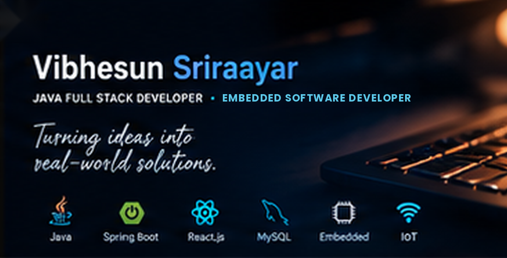

<!-- ======================================================= -->
<!--             VIBHESUN SRIRAAYAR | PROFILE README          -->
<!-- ======================================================= -->

<div align="center">

  

  <br/>

  <h1>Hi, I'm Vibhesun Sriraayar 👋</h1>

  <h3>JAVA FULL STACK DEVELOPER • ECE FINAL YEAR STUDENT</h3>

  <p>
    Building web applications with code & embedded systems with curiosity.
  </p>

  <a href="https://github.com/Vibhesun">
    
  </a>
  <a href="https://www.linkedin.com/in/vibhesun-sriraayar-a35a802a0/">
    
  </a>
  <a href="mailto:vibhem22@gmail.com">
    
  </a>

  <br/><br/>

  

</div>

---

## `> whoami`

```java
public class Vibhesun {

    String name = "Vibhesun Sriraayar";
    String role = "Aspiring Java Full Stack Developer";
    String education = "B.E. Electronics & Communication Engineering";
    String college = "Meenakshi College of Engineering";

    String[] backend = {
        "Java", "Spring", "Spring Boot",
        "REST APIs", "Hibernate", "JDBC", "Servlets"
    };

    String[] frontend = {
        "HTML", "CSS", "JavaScript", "React.js"
    };

    String[] database = {
        "MySQL", "Oracle SQL"
    };

    String[] embedded = {
        "Embedded C", "Arduino", "Sensors",
        "Microcontrollers", "IoT"
    };

    String goal =
        "Build useful software by combining problem-solving, " +
        "full-stack development and embedded technology.";
}
```

I'm an Electronics and Communication Engineering student focused on becoming a **Java Full Stack Developer**. I enjoy building web applications and exploring embedded systems, IoT, and hardware–software integration.

- 🔭 Currently developing my skills in **Java, Spring Boot, React.js and MySQL**
- 🌱 Learning to build scalable, practical full-stack applications
- ⚙️ Interested in embedded software, IoT and real-world engineering solutions
- 🎯 Goal: Grow as a software developer and contribute to meaningful projects
- 🤝 Open to learning opportunities, internships and collaborations

---

## `> tech_stack`

<div align="center">

### Languages


### Backend Development


### Frontend Development


### Databases & Tools


</div>

**Core technical skills**

- **Java:** Core Java, OOP, Collections, JDBC, Servlets
- **Backend:** Spring Framework, Spring Boot, REST APIs, Hibernate
- **Frontend:** HTML5, CSS3, JavaScript, React.js
- **Databases:** MySQL, Oracle SQL
- **Embedded systems:** Embedded C, Arduino, sensors, microcontrollers, IoT
- **Development workflow:** Git, GitHub, debugging and API integration

---

## `> featured_projects`

### 01. Sensor Gloves for Sign Language Translation

**Technologies:** Arduino Nano · Flex Sensors · Analog Accelerometer · HC-05 Bluetooth

An assistive embedded-system project designed to interpret finger movements and hand gestures. Flex sensors measure finger bending, while an accelerometer captures hand movement. The Arduino processes sensor readings and sends gesture information over Bluetooth to an Android application.

**Highlights**
- Sensor-based gesture recognition
- Bluetooth communication with an Android phone
- Hardware and software integration

### 02. Soil Nutrition System

**Technologies:** Embedded Systems · Sensors · IoT

An agriculture-focused project concept designed to support soil monitoring and smarter agricultural decisions using sensor technology and embedded systems.

**Highlights**
- Sensor-based soil monitoring concept
- Embedded-system integration
- Potential for IoT-based agricultural applications

### 03. E-commerce Website

**Technologies:** HTML · CSS · JavaScript

A web project focused on presenting products through a structured interface and creating a clear browsing experience.

**Highlights**
- Product-focused user interface
- Responsive layout principles
- Frontend development practice

### 04. Login Web Page

**Technologies:** HTML · CSS · JavaScript

A login interface built to practise form design, input handling, validation concepts and interactive web development.

### 05. Online Movie Ticket Booking System

**Technologies:** Java · Spring Boot · React.js · MySQL

A full-stack application concept for browsing movie information and managing ticket reservations through a frontend and backend connected to a database.

**Highlights**
- React-based frontend
- Spring Boot backend APIs
- MySQL database integration

---

## `> github_analytics`

<div align="center">

  

  

</div>

<div align="center">

  

</div>

---

## `> education`

**B.E. Electronics and Communication Engineering (ECE)**  
Meenakshi College of Engineering  
Expected graduation: 2026

---

## `> experience`

- **QSpiders** — Java Full Stack Internship / Training  
  October 2025 – Present

- **NSIC** — Embedded Systems Internship  
  October 2025 – January 2026

- **Mirror Technologies** — Embedded Systems Internship  
  July 2025 – August 2025

---

## `> current_focus`

```text
[████████░░] Java & OOP
[███████░░░] Spring Boot & REST APIs
[███████░░░] React.js
[███████░░░] MySQL & SQL
[██████░░░░] Embedded Systems & IoT
```

*Continuously learning, building projects, and improving through hands-on practice.*

---

## `> connect_with_me`

<div align="center">

  <a href="https://github.com/Vibhesun">
    
  </a>

  <a href="https://www.linkedin.com/in/vibhesun-sriraayar-a35a802a0/">
    
  </a>

  <a href="mailto:vibhem22@gmail.com">
    
  </a>

  <br/><br/>

  <i>"Build with purpose. Learn continuously. Turn ideas into reality."</i>

</div>
